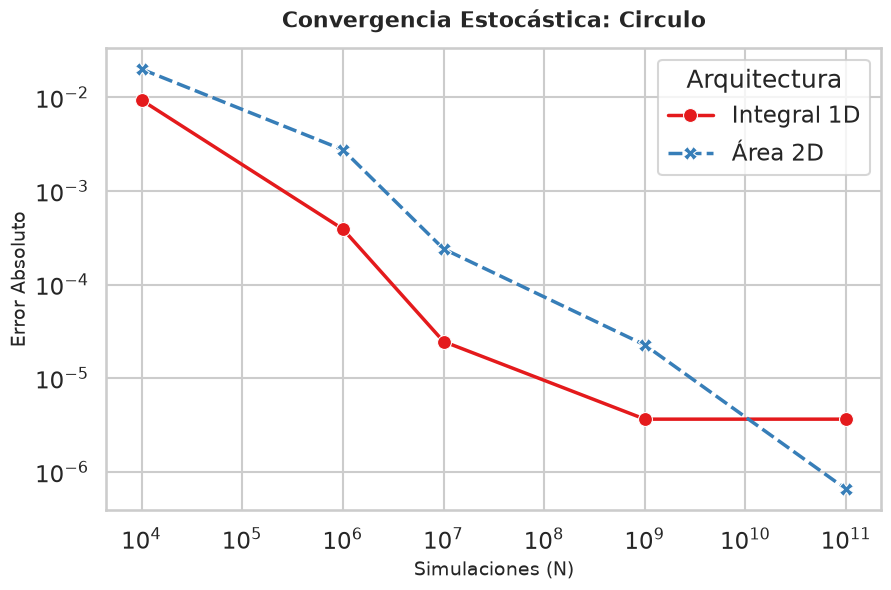
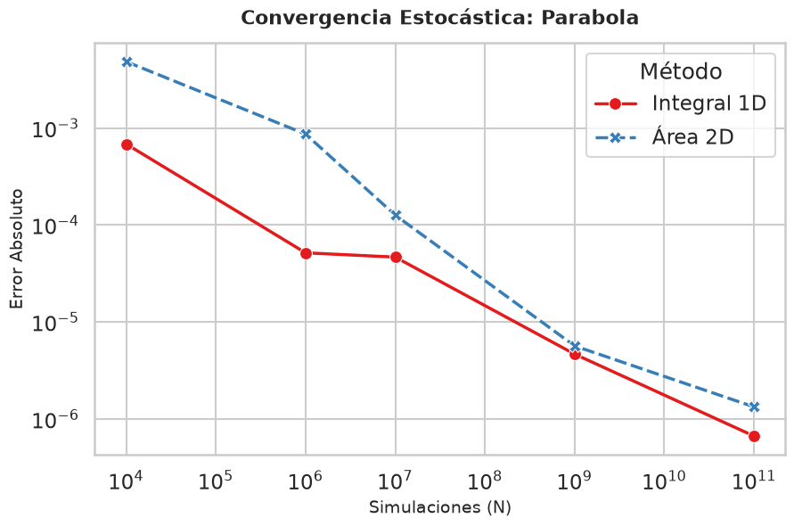
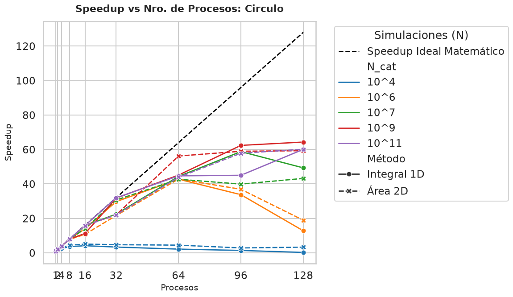
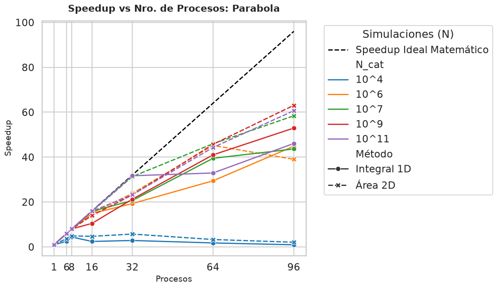
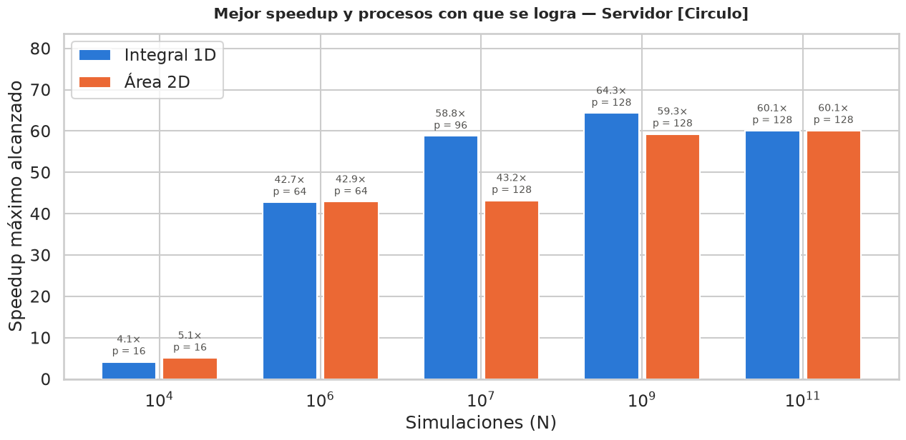
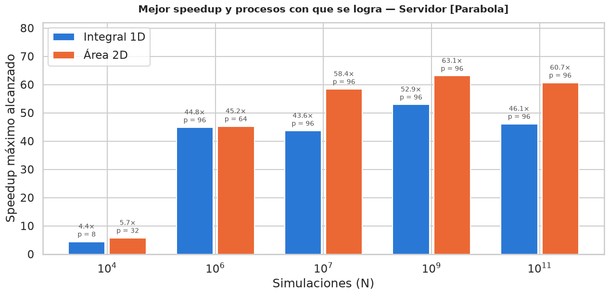
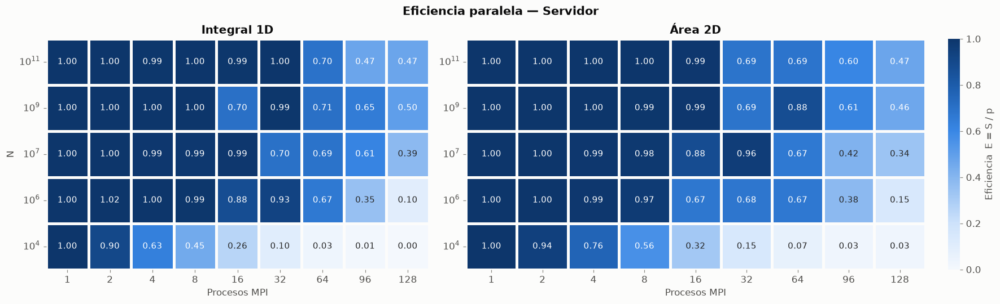
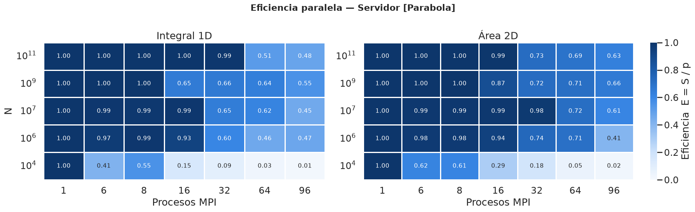
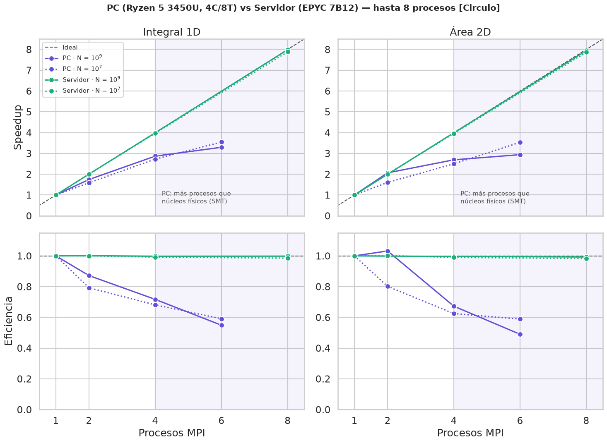
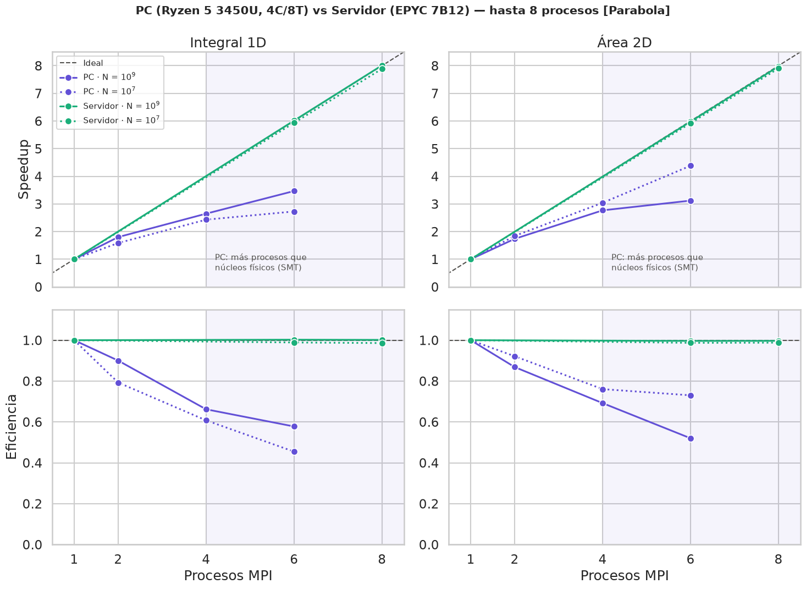

# Proyecto 4: Integración Numérica y Cálculo de Áreas Irregulares (HPC)

Este repositorio contiene la implementación paralela (MPI) orientada a resolver problemas mediante el Método de Monte Carlo, desarrollada para la asignatura Computación Científica - FACET - UNT.

El objetivo central es comparar el rendimiento, la convergencia y la escalabilidad (Speedup y Eficiencia) de dos enfoques topológicos distintos:
1. **Integración 1D** (Método del Valor Medio).
2. **Cálculo de Área Irregular 2D** (Método de Aceptación/Rechazo).

La pregunta que guía el trabajo es: **¿conviene más integrar en 1D o calcular el área por aciertos/fallos en 2D?**, y **¿cómo cambian esos resultados según la figura y según la arquitectura del equipo?**

### Geometrías Analizadas
Hemos decidido abordar el proyecto analizando dos figuras distintas, las cuales se someten a ambos algoritmos. Esto con el fin de tener un estudio más completo, para poder comparar resultados y llegar a una conclusión más robusta, siguiendo lo pedido en la consigna. Las figuras elegidas son:

1. **El Círculo Unitario ($r=1$):**
   * **En Integral 1D:** Se integra la función $f(x) = 2 \sqrt{1 - x^2}$ en el dominio $x \in [-1, 1]$. El factor 2 representa la altura total del círculo (parte superior e inferior), y el resultado de la integral es el área, $\pi$.
   * **En Área 2D:** Se lanza dentro de una caja de límites $[-1, 1] \times [-1, 1]$ validando la condición matemática $x^2 + y^2 \le 1$.
   * *Objetivo HPC:* Permite comparar qué operación es más costosa para la CPU: generar dos números aleatorios (x e y) vs generar uno solo pero forzar al hardware a evaluar una raíz cuadrada matemática (`sqrt()`).
2. **La Parábola ($y = x^2$):**
   * **En Integral 1D:** Se integra clásicamente $f(x) = x^2$ sobre el dominio $[0, 1]$.
   * **En Área 2D:** Se comprueba si el dardo cae bajo la curva evaluando lógicamente $y \le x^2$ en la caja $[0, 1] \times [0, 1]$.
   * *Objetivo HPC:* Al tener el menor costo de cálculo por muestra (una multiplicación), la Integral 1D de la parábola deja ver el peso del overhead de comunicación de MPI al escalar a muchos procesos.

---

## Decisiones de Diseño

A continuación, se detallan y justifican las decisiones de ingeniería tomadas durante el desarrollo.

### Balanceo de Carga (Load Balancing)
* Implementamos un **Balanceo de Carga Estático**. Cada proceso recibe una porción matemática idéntica, y el "resto" de la división entera se distribuye equitativamente sumando una iteración extra a los primeros procesos. Decidimos esto pues el método de Monte Carlo es un problema de naturaleza *Embarrassingly Parallel* (Vergonzosamente Paralelo), el costo de evaluar la función objetivo es idéntico en cada iteración y, al no existir intercambio de mensajes ni consultas en tiempo real entre los procesos para pedir más tareas, cada uno calcula su parte de corrido y no pierde tiempo coordinando. Un esquema Maestro-Trabajador hubiera introducido una cantidad masiva e innecesaria de comunicación entre los procesos (mensajes MPI de petición de tareas), arruinando la eficiencia.

### Elección del Generador Pseudoaleatorio (PRNG) y Reproducibilidad
* Inicialmente consideramos la implementación de la función clásica rand() de la biblioteca estándar de C que vimos en clase. Sin embargo, identificamos que, a gran escala (miles de millones), el generador agota su ciclo y comienza a repetir la misma secuencia de números. Esto sucede porque RAND_MAX también está en las cifras de los miles de millones (10^9 aprox).
 * Por esta razón, optamos por usar la familia drand48, estándar en POSIX, ya que amplía el espacio de estados a 48 bits (10^14 aprox.), lo cual garantiza que el ciclo no se agote en corridas masivas, y genera directamente un número en punto flotante double, ahorrando costo de conversión y división en cada iteración. Además, al ser estándar POSIX de C (stdlib.h), compila directamente con mpicc en cualquier PC o clúster sin necesidad de compilar paquetes de terceros.
 * También nos planteamos la idea de la reproducibilidad de los resultados, por lo que reemplazamos el uso de time(NULL), que dependía del reloj del sistema, y, en su lugar, implementamos un esquema de semillas reproducibles distanciadas. Usamos `srand48()` una sola vez por proceso para **sembrar** el generador, y después `drand48()` para obtener cada número al azar. En concreto, cada proceso arranca con `srand48(12345 + id * 999983)`: la base fija permite repetir el experimento y el salto entre procesos (un primo grande) evita que las secuencias se solapen.
 * Una consecuencia de usar una semilla fija es que, para un mismo N y un mismo número de procesos, las 5 repeticiones generan exactamente la misma secuencia de números, así que el valor estimado sale idéntico en las 5 (lo único que cambia es el tiempo). Por eso el análisis de error se hace sobre una única realización y no sobre un promedio; para promediar el error habría que variar la semilla en cada repetición. En cambio, entre distintos números de procesos el valor sí cambia, porque cambia qué parte de cada secuencia se consume.

### Elección del número de simulaciones y procesos
* Inicialmente se hicieron las pruebas en **PC**, utilizando un proceso más que la máxima capacidad de núcleos físicos, es decir, en vez de 4 procesos probamos 6. Esto fue posible con la función oversubscribe de MPI. En la PC la escala de procesos quedó en: 1, 2, 4 y 6.
* Para definir el número de simulaciones (N), decidimos consultar con el profesor, y, tras varias pruebas, dejamos la escala de N como: 10^4, 10^6, 10^7 y 10^9 para PC. Esta decisión se tomó teniendo en cuenta lo máximo que podría aguantar la PC frente al tiempo que nos llevaría el experimento.
* Para el **servidor** usamos la capacidad disponible (2× AMD EPYC 7B12: 128 núcleos físicos y ~512 GB de RAM). Para la primera toma de datos, que fue la del círculo, usamos la escala: 1, 2, 4, 8, 16, 32, 64, 96 y 128 procesos. Para la segunda figura, la parábola, se redujo a 1, 6, 8, 16, 32, 64 y 96 procesos; la justificación de esa reducción está en la sección de limitaciones y mejoras.
* Para el N del servidor agregamos 10^11 simulaciones al rango de la PC, por recomendación del profesor y para ver mejor el comportamiento de la paralelización en cargas muy grandes.
* En conclusión, los números de N y de procesos se eligieron teniendo en cuenta la máxima capacidad de cada dispositivo, para recoger la mayor cantidad de datos posibles. También se pensó en acotar el tiempo de ejecución en el servidor: la idea era que la corrida serial con el máximo N no tardara demasiado, pero el cálculo del Área 2D con N=10^11 terminó tardando cerca de 40 minutos (la Integral 1D tardó entre 16 y 23 minutos según la figura).

### Metodología de Medición y Análisis
* Lo que hicimos fue implementar el Método de Monte Carlo de Integración y Cálculo de área en dos figuras distintas, haciendo uso de la paralelización con MPI, para analizar su eficiencia. Este proceso se llevó a cabo en el servidor facilitado por la cátedra y en las PCs de las integrantes, para poder hacer un análisis y comparación de rendimiento entre los dispositivos.
* Utilizamos la función **MPI_Reduce** que realiza una operación de reducción global (como puede ser calcular el máximo, la suma, hacer un AND lógico, etc) sobre cada uno de los miembros del grupo. La operación de reducción puede ser tanto una predefinida de la lista de operaciones como una operación definida por el usuario. En nuestro caso la usamos para sumar los aportes parciales de cada proceso en la integral, y para sumar los aciertos totales en el método de Aceptación/Rechazo.
* Se utilizó un único MPI_Barrier previo a la captura del tiempo inicial con MPI_Wtime(). Si bien no es necesario para nuestro programa, ya que la operación de reducción es bloqueante de por sí, se tomó esta decisión con el fin de aportar buenas prácticas y rigurosidad al trabajo, ya que la operación garantiza la consistencia del benchmark al sincronizar la largada de todos los procesos distribuidos, evitando sesgos por el retardo de inicialización del runtime de MPI. Cabe aclarar que MPI_Wtime() es local de cada proceso; el punto donde todos se vuelven a encontrar es el MPI_Reduce final. No se incluyeron barreras adicionales dentro del bucle de simulación para preservar el asincronismo y evitar la degradación por el Efecto del Eslabón Más Lento (Straggler Effect). 
* **Medición del tiempo**: A la hora de tomar los tiempos de ejecución de la paralelización, surgió el planteo de cuándo deberíamos tomar el tiempo de fin (el tiempo de inicio era claro). La idea original fue la de hacerlo justo después de la operación de reducción, es decir, medir estrictamente el algoritmo paralelo. Pero se nos ocurrió que el cálculo que se hace dentro del proceso raíz podría afectar al tiempo total y ser significativo. Luego de investigar en foros, decidimos optar por la primera alternativa, ya que es la regla metodológica obligatoria en la comunidad de HPC, y el cálculo es trabajo serial secundario del proceso 0 y no significa un costo significativo de tiempo.

## Análisis de los Resultados

En base a los fundamentos de HPC y de los métodos estocásticos, a la hora de interpretar las gráficas obtenemos los siguientes resultados para cada una de las figuras analizadas (círculo y parábola).

### Convergencia del Error Absoluto
Por la Ley de los Grandes Números, a medida que $N$ aumenta, el error debe decrecer de forma inversamente proporcional a la raíz cuadrada de $N$ ($1/\sqrt{N}$). En nuestra gráfica Log-Log, esto se debe observar como una línea recta descendente y constante.

**Resultados**

En el círculo, el error baja de forma esperada hasta las $10^9$ simulaciones, donde la Integral 1D sufre un estancamiento: el error deja de disminuir, aunque no aumenta, y se mantiene alrededor de $10^{-6}$. Ese estancamiento sucede porque el valor estimado se imprime con 6 decimales, así que el programa ya no puede distinguir errores menores a $\sim 10^{-7}$. El Área 2D no muestra ese estancamiento y sigue bajando el error a medida que aumenta N.

En la parábola el comportamiento es parecido. La Integral 1D también se estanca un poco entre $10^6$ y $10^7$ ($10^{-5}$), pero después sigue bajando hasta $10^{-7}$ con $10^{11}$ simulaciones. El Área 2D baja el error de forma continua en todo el rango. En casi todo el rango la Integral 1D tiene menos error que el Área 2D, porque cada muestra aporta un valor continuo en lugar de solo un acierto o un fallo.

Esa diferencia se explica por la varianza de cada método. La Integral 1D acumula valores continuos y su desviación por muestra depende solo de la función: $\sigma \approx 0.89$ en el círculo y $\approx 0.30$ en la parábola. El Área 2D es una prueba de acierto/fallo (Bernoulli) y su varianza depende de la tasa de aceptación: $\sigma \approx 1.64$ en el círculo ($p \approx 0.79$) y $\approx 0.47$ en la parábola ($p \approx 0.33$). Como el error va como $\sigma/\sqrt{N}$, la Integral 1D llega al mismo error con menos simulaciones.

### Speedup Real vs Ideal
El Speedup Ideal traza una línea recta (donde $P$ procesos reducen el tiempo $P$ veces). En la realidad, la línea de nuestro código correrá por debajo de la ideal. La separación entre ambas líneas representa el *overhead* (el costo de inicializar MPI, balancear variables, y la comunicación final en el `MPI_Reduce`).

**Resultados**

Para un N muy pequeño ($10^4$) la paralelización es ineficiente y no conviene usarla. El mejor speedup con $10^4$ apenas llega a 4-5 veces, y en el círculo la Integral 1D con 128 procesos es 4 veces más lenta que en serie ($S = 0.25$).

Para $N \ge 10^6$ y hasta 8 procesos, las curvas se pegan a la diagonal ideal (eficiencia cercana a 1), tanto en el círculo como en la parábola. Desde 16-32 procesos las curvas se separan del ideal, y para ese rango de N el mejor speedup queda entre 43 y 63 veces, y se consigue con 64-96 procesos (o 128 en el círculo).

En este punto es interesante explicar la arquitectura del servidor. Entre 1 y 64 procesos todos los núcleos están en el Socket 0 y la comunicación es local al chip. Al pasar de 64 procesos, MPI tiene que usar el Socket 1 y la comunicación ya no viaja por el silicio local, sino por el bus inter-socket AMD Infinity Fabric. Eso explica parte del estancamiento a partir de 64 procesos.

De todas formas, la caída no se explica solo por la comunicación: un único `MPI_Reduce` de 8 bytes cuesta microsegundos, mientras que el cálculo dura segundos o minutos. Lo que más influye es que cada núcleo trabaja más lento cuando hay muchos activos (baja la frecuencia y el servidor es compartido por otras tareas). Por eso hay mediciones de 0.70 y otras de 0.99 para la misma cantidad de procesos.

### ¿Con cuántos procesos conviene correr cada N?

En un principio, la intuición nos haría pensar que mientras más procesos, más rápido y mejor funciona el programa. Luego de llevar a cabo los experimentos, podemos ver que el Speedup mejora a medida que el número de procesos aumenta, pero solo hasta cierto punto que depende de N.

Las siguientes gráficas nos aclaran las cosas:

En el círculo, para $N=10^4$ el mejor Speedup se logra con 16 procesos, para $10^6$ con 64, y a partir de $10^7$ con 96-128 procesos. En la parábola, que se midió como máximo hasta 96 procesos, los mejores resultados aparecen con 8-32 procesos para $10^4$ y con 64-96 desde $10^6$. En las dos figuras se repite el mismo patrón: la cantidad óptima de procesos crece con N.

### Eficiencia
La eficiencia inicia en 1.0 (o 100%) para 1 proceso. Debería ir decayendo a medida que agregamos núcleos. Esta caída es consecuencia de que el bus de memoria caché se satura cuando todos los procesadores intentan consultar datos o escribir variables simultáneamente, y de la bajada de frecuencia cuando trabajan todos los núcleos.

**Resultados**

En las gráficas se puede apreciar que el algoritmo paraleliza casi perfectamente (eficiencia cercana a 1) hasta 8-16 procesos para N grande, tanto en el círculo como en la parábola. Con 64 procesos la eficiencia queda en 0.46-0.88 según N, y con 96-128 baja a 0.10-0.66. La caída no es suave: hay celdas de 0.99 junto a celdas de 0.70 para la misma cantidad de procesos, lo que confirma que la pérdida no viene de la comunicación. La fila $N=10^4$ se aclara enseguida (≤ 0.6 desde pocos procesos), porque el problema es demasiado chico para repartirlo.

### Comparación de Rendimiento: PC Local vs Servidor HPC

En el rango común (hasta 8 procesos), la diferencia entre la PC y el servidor es clara:

1. El servidor (representado por líneas verdes) se comporta de forma casi ideal.
   - Speedup: crece acompañando a la línea ideal hasta 8 procesos.
   - Eficiencia: se mantiene cercana a 1, tanto en el círculo como en la parábola.
2. La PC se limita por su arquitectura: solo tiene 4 núcleos físicos.
   - Con 2 procesos la eficiencia suele quedar en 0.8-0.9 (para N grande).
   - Con 4 procesos baja a 0.6-0.76, aunque todavía hay un núcleo por proceso.
   - Con 6 procesos llega a un speedup de 2.9-3.5, apenas por encima de lo que logra con 4. Los procesos extra comparten núcleo mediante SMT y aportan poco.
3. Aceleración Superlineal (Efecto Caché)
   Este fenómeno aparece solo en un caso: el cálculo de **Área 2D** del círculo en la PC, con $N=10^9$ y **2 procesos MPI**.
   - El Speedup llega a 2.06 y la eficiencia supera 1.0 (103%).
   - Esto se conoce como **aceleración superlineal**. Al repartir el bloque de $10^9$ elementos entre 2 procesos, los datos encajan mejor en la memoria caché local de cada núcleo.
   - Al resolver el problema usando la caché rápida en lugar de ir constantemente a la memoria RAM (más lenta), el procesador ahorra más tiempo del que predice sumar un proceso extra.
   - En la parábola no se observó este efecto: el Área 2D con $N=10^9$ y 2 procesos da un Speedup de 1.74 y una eficiencia de 0.87.

### Comparación final: Integral 1D vs Área 2D

La siguiente tabla resume el resultado central del trabajo. Los costos y las varianzas son del servidor con 1 proceso; el speedup es el mejor alcanzado con $N=10^9$:

| Método | Figura | Costo por muestra | $\sigma$ por muestra | Mejor speedup ($N=10^9$) |
| :--- | :--- | :--- | :--- | :--- |
| Integral 1D | Círculo (`sqrt`) | 13.7 ns | 0.89 | 64× con 128 procesos |
| Área 2D | Círculo | 22.4 ns | 1.64 | 59× con 128 procesos |
| Integral 1D | Parábola ($x^2$) | 9.6 ns | 0.30 | 53× con 96 procesos |
| Área 2D | Parábola | 23.8 ns | 0.47 | 63× con 96 procesos |

El Área 2D cuesta entre 1.6 y 2.5 veces más por muestra que la Integral 1D, porque genera dos números aleatorios por muestra en lugar de uno. La Integral de la parábola es la más barata porque no tiene `sqrt`. En cambio, el speedup y la eficiencia no dependen tanto del método como de la arquitectura: los cuatro casos llegan a valores parecidos cuando N es grande. Por eso, la elección entre Integral y Área es sobre todo una elección de costo por muestra y de precisión, no de escalabilidad.

Un dato para tener presente: el Área 2D de la parábola (23.8 ns) sale algo más lenta que la del círculo (22.4 ns), aunque su condición es más simple. La causa más probable es la predicción de saltos del `if`: en el círculo acierta el 79% de las veces y en la parábola solo el 33%.

## Limitaciones y Mejoras Futuras

A lo largo del proceso de investigación y prueba tomamos decisiones y descubrimos limitaciones o mejoras que se pueden resolver o implementar a futuro.

### Elección del Generador Pseudoaleatorio (PRNG)
En nuestro código base priorizamos la portabilidad estándar POSIX con drand48(). 
Luego de implementar, descubrimos que para paralelizacion el drand() tiene problemas para la reproducibilidad en simulaciones cientificas. Al no haber control sobre qué hilo accede primero a la función global, el orden en el que se actualiza el estado cambia en cada ejecución, dependiendo puramente del planificador del sistema operativo (OS scheduler). Esto resulta en que, aunque usemos la misma semilla inicial, cada ejecución paralela dará valores aleatorios diferentes

Para una futura versión, la mejora recomendada es migrar a generadores basados en contadores como Philox (Random123) o bibliotecas especializadas como SPRNG.

### Elección de N y procesos
En la sección donde explicamos por qué tomamos los números que tomamos, se aclara que hubo una reducción en el número de procesos para la segunda figura estudiada, que fue la parábola.

Cuando hicimos las pruebas con los valores originales, la ejecución en total nos tomó 12 horas. Consultando con el profe y debatiendo en grupo, concluimos que era demasiado tiempo, así que se limitó la máxima capacidad de cómputo para que el experimento se lleve a cabo en un tiempo más corto. Consideramos esta decisión la más óptima para este proyecto, ya que no afecta en gran medida a las conclusiones finales.

Por último, se decidió tomar 5 repeticiones por número de procesos, por la misma razón de optimizar tiempos. Estas repeticiones usaron la misma semilla, así que el valor estimado se repite en las 5 (solo varía el tiempo), y por eso el análisis de error se apoya en una sola realización.

Para una futura versión, la mejora recomendada es medir ambas figuras con la misma cantidad de procesos, o bajar el número de N y aumentar la cantidad de repeticiones usando una semilla distinta en cada una. Así se podría promediar el valor estimado y el error en lugar de depender de una única corrida, lo que daría un conjunto de datos más robusto.

### Caso de Uso: Área de una figura irregular
Se planteó en consulta la ejecución de un caso de aplicación real sencillo, para probar el rendimiento del programa (en específico, el cálculo de Área 2D) con una figura verdaderamente irregular. Se pensó en el área encerrada entre dos calles perpendiculares y un río con forma sinusoidal.

Por falta de tiempo se decidió no llevarlo a cabo, pero consideramos que es una idea interesante para probar el Método de Monte Carlo con un caso más cercano a la realidad.

**Mejoras necesarias para implementarlo:**
- Generalizar la condición de aceptación en los archivos `.c`. Hoy la figura está fija (círculo o parábola) y habría que permitir que la frontera se defina con una función, por ejemplo `y <= sin(x)`, dentro de una caja.
- Elegir bien la caja que contiene la figura. Si la caja es mucho más grande que el área irregular, se aceptan menos dardos y el error sube para el mismo N, porque la varianza del Área 2D depende de la tasa de aceptación.
- Calcular el área real para comparar el error. En el caso sinusoidal se puede resolver por integral definida, así que sirve de referencia; para un mapa real habría que usar otra herramienta.
- Agregar un gráfico de la figura para verla, ya que al ser irregular no alcanzan las condiciones conocidas del círculo o la parábola.

**Limitaciones que tendría:**
- Evaluar una frontera arbitraria (por ejemplo `sin()`) agrega costo por muestra, distinto al de las figuras actuales, así que habría que volver a medir tiempos y speedup.
- El error seguiría bajando como $1/\sqrt{N}$, así que para una figura muy irregular haría falta un N grande para lograr la misma precisión que en el círculo o la parábola.

## Resumen de Resultados Clave

- **Convergencia:** los dos métodos cumplen la Ley de los Grandes Números (el error baja como $1/\sqrt{N}$). La Integral 1D tiene menos error que el Área 2D en casi todo el rango porque su varianza es menor.
- **Costo por muestra:** la Integral 1D es más barata que el Área 2D (9.6-13.7 ns frente a 22-24 ns), porque el Área usa dos aleatorios por muestra.
- **Escalabilidad:** hasta 8 procesos la eficiencia es cercana a 1; con 64-96 procesos el speedup llega a 43-63×. Con $N=10^4$ no conviene paralelizar.
- **Hardware:** el servidor escala de forma casi ideal dentro de un socket (64 procesos) y a partir de ahí se estanca; la PC se limita a sus 4 núcleos físicos y el SMT aporta poco.
- **Elección:** para un mismo error conviene la Integral 1D (menos costo y menos varianza); el Área 2D es más costosa, pero es la única opción cuando la figura no se puede escribir como integral 1D.

## Conclusión

El desarrollo de este proyecto y el análisis de los datos permitieron comprobar de forma práctica los principios de HPC aplicados a métodos estocásticos:

1. **Precisión y convergencia:** Los dos métodos (Integración 1D por Valor Medio y Área 2D por Aceptación/Rechazo) cumplen la Ley de los Grandes Números: el error absoluto baja a razón de $1/\sqrt{N}$. Usar `drand48()` con semillas reproducibles y distanciadas fue necesario para no agotar el periodo del generador en corridas de hasta $10^{11}$ iteraciones y para poder comparar los experimentos. En las dos figuras la Integral 1D tiene, en general, menos error que el Área 2D, porque su varianza es menor.

2. **Escalabilidad y Ley de Amdahl:** Al ser un problema paralelizable por naturaleza (*Embarrassingly Parallel*), el reparto estático de carga combinado con una sola operación colectiva (`MPI_Reduce`) fue suficiente y no generó cuellos de botella por paso de mensajes. Los datos muestran que más procesos no siempre es mejor: para $N = 10^4$ el costo de arrancar y sincronizar MPI pesa más que el cálculo (el speedup no pasa de 4-5 veces y en el círculo la Integral 1D con 128 procesos es 4 veces más lenta que en serie). Desde $N \ge 10^6$ el cálculo domina y el servidor alcanza 43-63 veces con 64-96 procesos.

3. **Arquitectura del hardware:** El rendimiento no depende solo del código. El servidor escaló de forma casi ideal hasta 8 procesos y luego se estancó cerca de 60 veces, por la bajada de frecuencia y porque a partir de 64 procesos se usa el segundo socket (bus AMD Infinity Fabric). La PC se limitó a sus 4 núcleos físicos: con 6 procesos (usando SMT) la ganancia es poca, porque los procesos comparten las mismas unidades de punto flotante. La RAM no influyó en ningún caso, porque los dos programas usan memoria $O(1)$.

4. **Comparación de las dos figuras:** La parábola y el círculo se comportan de forma parecida: se paralelizan igual y el error baja igual. La diferencia está en el costo por muestra. La parábola es la más barata de evaluar ($x^2$ y la comparación $y \le x^2$): unas 9.6 ns por muestra en el servidor. El círculo necesita una raíz cuadrada, así que su Integral 1D tarda 13.7 ns por muestra. El Área 2D es la más costosa en las dos figuras (22-24 ns por muestra), porque genera dos números aleatorios por muestra. En las dos figuras la Integral 1D fue la opción más barata y precisa, y el Área 2D la más costosa.

## Bibliografía
- [Dynamic Load Balancing of Parallel Monte Carlo Transport Calculations](https://www.osti.gov/biblio/15015938)
- [drand48](https://pubs.opengroup.org/onlinepubs/007904975/functions/drand48.html)
- [MPI_Reduce](https://lsi2.ugr.es/jmantas/ppr/ayuda/mpi_ayuda.php?ayuda=MPI_Reduce)
- [When do I need to use MPI_Barrier()?](https://stackoverflow.com/questions/13305814/when-do-i-need-to-use-mpi-barrier)
- [MPI global execution time](https://stackoverflow.com/questions/5298739/mpi-global-execution-time)
- [How do I interpret the results from MPI_Wtime()?](https://scicomp.stackexchange.com/questions/29876/how-do-i-interpret-the-results-from-mpi-wtime)
- [¿Qué es la Ley de Amdahal?](https://builtin-com.translate.goog/articles/amdahls-law?_x_tr_sl=en&_x_tr_tl=es&_x_tr_hl=es&_x_tr_pto=tc)
<!-- 
💡 CONSEJOS Y RECOMENDACIONES OCULTAS PARA TU DEFENSA ORAL: 
1. Anomalías con N pequeños (ej. N=10.000): Si observas que con 10.000 simulaciones usar 8 procesos demora MÁS TIEMPO que usar 1 proceso (Speedup menor a 1), ¡no te asustes y úsalo a tu favor! Explícale al profesor que "para problemas diminutos, el costo de coordinar y enviar mensajes entre los nodos de MPI demora más tiempo que simplemente resolver la matemática localmente".
2. Caídas bruscas de Eficiencia: Si pruebas en un servidor de 16 núcleos y notas que al pasar del núcleo 8 al 16 la eficiencia se desploma, menciona la arquitectura del procesador. Usualmente es porque esos núcleos extra son "lógicos" (Hyper-Threading) y no núcleos físicos independientes, por lo que se pelean por la misma memoria física caché L1/L2.
3. Diferencia Integral vs Área: Al comparar, recordá que el Área 2D usa dos aleatorios por muestra y por eso cuesta ~1.6-2.5x más que la Integral 1D, pero el speedup es parecido en ambos métodos porque se paralelizan igual. La Integral de la parábola es la más barata (no tiene sqrt); su Área 2D es apenas más lenta que la del círculo por la predicción de saltos del if (33% de aciertos vs 79%).
-->
